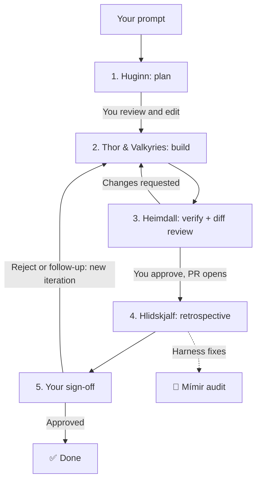

# Odin ⚡

**A review loop for coding agents.** Odin is a Claude Code and Antigravity plugin that turns a big development task into a tracked, five-phase loop: plan, build, verify, reflect, sign off. Every task gets a live HTML page that shows what the agent planned, what it did and why, and a dashboard where you approve, revise or reject with one click. The agent pauses at the moments that matter and wakes back up when you decide.

## Why use it

Long agent tasks usually fail in the same few ways: the agent charges off in the wrong direction, you lose track of what it did, the diff lands in a PR you never really reviewed, and the same mistake shows up again next week. Odin is built around those failures.

- **You approve the plan before any code is written.** Huginn writes steps, the exact test commands and a Definition of Done. You can edit the plan inline, then launch execution.
- **You can see what happened, not only how it ended.** Each phase has a timeline of commits, test runs (✅/❌), subagent dispatches, findings, decisions and plan changes, filled in automatically by hooks.
- **Nothing reaches a PR without your review.** Heimdall checks the work against the Definition of Done, then shows a full diff with context, the agent's rationale and a note for every file. The PR only opens after you approve it.
- **No babysitting the terminal.** When Odin needs you, it sends a notification and waits. Click a button in the dashboard, from any device, and the session resumes on its own. No copy-pasting answers back into chat.
- **Rejections don't erase history.** Sending work back starts a new iteration and keeps every earlier attempt, with the reason and the root cause of the miss.
- **The harness gets better over time.** After a task that needed retries, Hlidskjalf proposes a fix to the skill, rule, script or test gate that let the mistake happen. You review those proposals later and turn the good ones into their own tasks.
- **Parallel work doesn't collide.** Independent pieces fan out to subagents that each own a separate set of files. Concurrent Odin tasks get their own git worktrees and dev-server ports.

## How it works

You start a task with `/odin:odin <task>`. Odin creates a state file at `<workspace>/odin-states/<task-slug>.html` and starts a small local server that serves it, plus a dashboard of every Odin task across your repos at <http://127.0.0.1:8788/>.



| Phase | What happens | Where you come in |
|---|---|---|
| **1. Huginn** (plan) | Reads the request and the codebase. Writes the environment (branch, worktree, ports), ordered steps, testing strategy, Definition of Done, and which parts can run in parallel. | Edit the plan, answer open questions, pick skills to run, then **Save & Launch Phase 2** or **Ask Huginn to Revise**. |
| **2. Thor & the Valkyries** (build) | Thor executes the plan, handing independent parts to Valkyrie subagents with disjoint file ownership. Valkyries only edit; Thor is the only one who commits. | Watch the timeline fill in. |
| **3. Heimdall** (verify) | Runs the planned checks against the Definition of Done and renders a diff review: 12 lines of context, a rationale banner, per-file notes, split or unified view, word-level highlights, line comments. | **Approve Code Diff & Open PR** or **Request Code Changes**. |
| **4. Hlidskjalf** (retrospective) | Reviews plan adherence and what slowed things down. If the task needed retries, records a harness delta proposal pointing at the file the fix belongs in. | Review proposals later in the Mímir audit. |
| **5. Human validation** | Asks for final sign-off on the linked PR. | **Sign Off & Mark Done** or **Reject**. A rejection starts the next iteration. |

### The state file

The state file is the single source of truth for a task. It's a plain HTML page you can open, share or keep, and it holds:

- one card per phase per iteration, each with a summary and a timeline;
- the branch, worktree, ports and session the task runs in;
- open questions, the diff review and your comments;
- the PR link once it exists;
- the ledger of harness delta proposals.

The agent updates it through `odin-state.py` the moment a phase changes status, so the page is always current. Iterations are append-only: earlier cards collapse but stay intact.

### The wakeup bridge

When Odin pauses for you (plan review, pre-PR review, final sign-off), it marks the phase **awaiting human**, asks its questions both on the page and in chat, and starts a watcher as a background command. The dashboard shows **🟢 PARTNER TURN**. When you click a decision, the watcher prints your decision, notes and any selected skills, then exits. Claude Code and Antigravity re-invoke the agent when a background command exits, so the session picks up exactly where it stopped. If you'd rather answer in chat, that works too.

### Hooks

Odin's plugin hooks do the bookkeeping so the agent doesn't have to remember it:

- **SessionStart** tags the session so a state file can link back to it.
- **PostToolUse / SubagentStop** log every `git commit`, every test, lint, typecheck, format and build command (✅ pass, ❌ fail, ⏳ backgrounded), and every subagent dispatch and return, into the active task's timeline. Failed `git` or `gh pr` commands and killed background tasks are logged as 🚨 incidents. Turn this off with `"progress": {"capture": false}`.
- **PreToolUse** (only when you configure `pr`) adds a label, session telemetry and your verbatim prompts to PR bodies, and asks you to confirm the rewritten command.

### Getting better between tasks

When a task needed more than one iteration, failed Heimdall, or exposed a gap, Hlidskjalf writes a harness delta proposal: the category (skill, rule, script or test gate), the file the fix belongs in, the failure pattern and a proposed change. Proposals don't touch the feature branch. Open the dashboard's **🧠 Mímir Harness Audit** to review them across all tasks. **⚡ Approve & Spawn Delta Ticket** turns one into its own Odin task, starting at Phase 1, and copies a launch prompt you can paste into a fresh session.

Friction can't slip through quietly either: if an iteration logged an incident or a failed check, Hlidskjalf can't finish until it records a delta for it or gives a reason why it was a one-off. Recurring mistakes get fixed where they start instead of being corrected by hand each time.

## Install

```bash
claude plugin marketplace add Conor-Hinchee/odin
claude plugin install odin@odin
```

Then, in a session, run `/odin:odin <your task>`, or ask Claude to "boot up Odin" to start the dashboard at <http://127.0.0.1:8788/>.

Odin has no version number: every commit on `main` is a new release. To get updates automatically, run `/plugin`, open **Marketplaces**, select **odin** and choose **Enable auto-update**. A running session keeps the version it loaded until you run `/reload-plugins`.

**Antigravity:** clone or symlink this repository into `~/.gemini/config/plugins/odin` (or `<workspace>/.agents/plugins/odin`). Antigravity loads root `plugin.json`, `hooks.json`, and `skills/odin/SKILL.md` automatically.

Requirements: Python 3.10+, git, and `lsof`. macOS and Linux are supported.

### Notifications

Odin alerts you on every phase change in up to three places:

- **Browser.** Open the dashboard or a state page in a regular browser and click **🔔 Enable Alerts**. Clicking a notification focuses the tab. Browsers embedded in other apps, such as the Claude Code browser pane, usually block notifications; there you get an in-page toast and chime instead.
- **Desktop banner.** On macOS, install [terminal-notifier](https://github.com/julienXX/terminal-notifier) (`brew install terminal-notifier`) so clicking a banner opens the task's page. Without it, Odin falls back to `osascript`, whose banners open Script Editor when clicked. On Linux, banners use `notify-send`.
- **No duplicates.** While an Odin page with browser notifications allowed is open, it covers its own task (the dashboard covers every task) and the desktop banner is skipped.
- **Off switch.** Set `ODIN_NOTIFY=0` in the environment to silence desktop banners and chimes, for example in scripted or eval runs.

### Remote access

The server listens only on `127.0.0.1` by default. To approve tasks from your phone or another computer, serve over HTTPS, or use a local domain like `https://odin.dev/`, see [docs/remote-access.md](docs/remote-access.md). **There is no authentication**: anyone who can reach the port can approve, reject or wake the agent, so only expose it on a network you trust.

## Configure (optional)

Odin works with no config. To add repos for worktree and port isolation, a deployment-telemetry table, custom skill pills, PR telemetry, or a different port, copy [`odin.config.example.json`](odin.config.example.json) to one of these locations and edit it:

- `~/.config/odin/config.json` for all workspaces
- `<workspace>/.odin/config.json` for one workspace
- any path named in `$ODIN_CONFIG`

These are merged in that order, with later ones winning. To print the effective config:

```bash
python3 skills/odin/scripts/odin_config.py
```

| Key | Purpose |
|---|---|
| `root` | Folder the dashboard scans (three levels deep) for `odin-states/` |
| `ports` | `live` (8788) and `staging` (8789) |
| `server` | `host` interface, optional TLS `cert`/`key`, and `allowed_hosts` for custom domains or reverse proxies |
| `repos` | Repos `odin-isolate.py` may allocate worktrees and ports for (see [isolation](skills/odin/references/isolation.md)) |
| `telemetry` | A command that prints a JSON array, shown as a table on the dashboard |
| `skill_pills` | Skills offered as one-click pills when approving a plan |
| `pr` | Turns on the PR hook: label, telemetry section, verbatim prompts, `Rule #12` → `Rule 12` |
| `progress` | `capture: false` turns off automatic timeline logging |
| `staging` | Paths for the `:8789` sandbox used to develop Odin itself |

### Run the dashboard at login (macOS)

Create `~/Library/LaunchAgents/com.odin.server.plist` with `ProgramArguments` set to `python3 <path>/skills/odin/scripts/odin-server.py --dir <your root>`, with `RunAtLoad` and `KeepAlive` both true. Then run `launchctl load ~/Library/LaunchAgents/com.odin.server.plist`. Because `KeepAlive` immediately respawns the primary checkout's server if its PID is killed, use the `:8789` staging server when testing server changes from a worktree, or unload the plist (`launchctl unload ~/Library/LaunchAgents/com.odin.server.plist`) first.

## Develop

```bash
git clone https://github.com/Conor-Hinchee/odin && cd odin
python3 -m unittest discover tests
claude plugin validate .
claude --plugin-dir .
```

To work on Odin from your checkout in everyday sessions, add it as the marketplace (`claude plugin marketplace add /path/to/odin`). Local marketplace plugins load in place, so edits apply on the next session or `/reload-plugins`.

When your checkout is symlinked as a live plugin (`~/.gemini/config/plugins/odin` or a local Claude marketplace), keep the primary checkout on `main` and create a `git worktree` (`git worktree add ../odin-<feature> -b feat/<feature>`) for feature branches so active sessions and the live `:8788` server never drift off `main`. Running from a checkout also enables the `:8789` staging sandbox (see [skills/odin/references/staging.md](skills/odin/references/staging.md)). The full command reference is in [skills/odin/references/cli.md](skills/odin/references/cli.md).

## License

[MIT](LICENSE)
