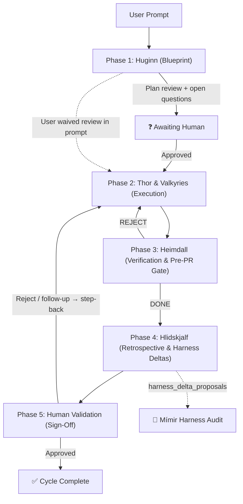

# Odin: The Allfather Agentic Workflow

Odin runs a task through five phases and records every phase in a live HTML **state file**, `<workspace>/odin-states/<task-slug>.html`. A small local server (`127.0.0.1:8788`) serves those files and a dashboard of every Odin project, and lets the human approve, revise or reject from the browser.

Scripts live in `${CLAUDE_SKILL_DIR}/scripts/`. In the commands below, `ODIN=${CLAUDE_SKILL_DIR}/scripts`.

| Script | Use |
|---|---|
| `odin-server.py` | Dashboard + state server (`--dir <root> --port 8788`) |
| `odin-state.py` | Phase updates, iterations, diffs, wakeups, deltas, staging. See [references/cli.md](references/cli.md) |
| `odin-isolate.py` | Worktree + port allocation for configured repos. See [references/isolation.md](references/isolation.md) |
| `odin-progress-hook.py` | Plugin hook that logs commits, check commands and subagents into the active task's timeline |
| `odin-notify.sh` | Desktop notification + chime (click opens the task page via terminal-notifier on macOS) |

Optional settings (repos, ports, telemetry, skill pills, PR telemetry, staging) come from `~/.config/odin/config.json` or `<workspace>/.odin/config.json`. Run `python3 "$ODIN/odin_config.py"` to print the effective config. Everything works with no config.

---

## Ground rules (MANDATORY)

1. **One state file per task.** Store it at `<workspace>/odin-states/<task-slug>.html`, using a descriptive kebab-case slug (`checkout-form-validation`, `migrate-auth-to-jwt`). Create the directory if needed. Before creating a file, list `odin-states/` and resume an existing file if this is the same task. Never write a shared root `odin_state.html`.
2. **Start from the template.** New state files start from [references/state-template.html](references/state-template.html). Fill in the title and slug, and stamp `<body>` with what you know:
   ```html
   <body data-branch="feat/<task-slug>" data-worktree="<absolute repo or worktree path>"
         data-app-port="<port or empty>" data-backend-port="<port or empty>"
         data-session-id="<session id>">
   ```
   The session id appears in your context as `Odin session id: <id>` (added by the plugin's SessionStart hook). Omit the attribute if it is not there.
3. **Ensure the server is running** when you start a project or the user asks to boot Odin:
   ```bash
   lsof -nP -iTCP:8788 -sTCP:LISTEN || nohup python3 "$ODIN/odin-server.py" --dir "<odin root>" >/tmp/odin-server.log 2>&1 &
   ```
   `<odin root>` is the configured `root`, or a parent folder of your repos (the server scans three levels deep for `odin-states/`). `<base url>` below is the output of `python3 "$ODIN/odin_config.py" --url`: `http://127.0.0.1:8788` by default, `https://…` when the user configured TLS. If the user asked to boot Odin, also open `<base url>/` (`open` on macOS, `xdg-open` on Linux).
4. **Show the links** at the top of every phase update:
   - `[🌐 Open <task-slug>](<base url>/<path-from-root>/odin-states/<task-slug>.html)`
   - `[🏛️ Odin Dashboard](<base url>/)`
   - the state file path
5. **Update status in real time.** Mark a phase `active` when it starts, and `done`, `reject` or `awaiting_human` the moment it ends, using `odin-state.py update-phase`. Never batch status updates at the end of a turn.
   - `update-phase` only touches the current `data-iteration="N"` card, and never loses that card's timeline. With only `--summary`, it keeps the card's existing body.
   - Whenever the status actually changes, `update-phase` notifies (desktop banner and chime; clicking opens the task page) and adds a 🚦 entry to the timeline. `step-back` does the same for a new iteration. Don't call `odin-notify.sh` yourself for phase changes. The one manual call is when you bootstrap a task, because a new state file already starts with Huginn `active`:
     ```bash
     sh "$ODIN/odin-notify.sh" "Phase 1: Huginn" "<one-line status>" phase "odin-states/<task-slug>.html"
     ```
6. **Log progress as it happens.** Every iteration card has a timeline, so the state file should show what happened during a phase, not only how it ended.
   - The plugin's progress hook adds entries on its own for every `git commit`, every check command (tests, lint, typecheck, build, with pass/fail), and every subagent dispatch and return.
   - Log everything else with `log` the moment it happens, not at the end of the phase. `log` never changes status and never notifies:
     ```bash
     python3 "$ODIN/odin-state.py" log --file "odin-states/<task-slug>.html" --kind <kind> --text "<one line>" [--detail "<longer output>"]
     ```

     | When | `--kind` |
     |---|---|
     | You record a baseline, or a check result the hook didn't see (run by a subagent, or checked by hand) | `test` with `--outcome pass\|fail` |
     | You find something unexpected: a bug, a regression, a root cause | `finding` |
     | You pick between approaches or accept a trade-off | `decision` |
     | The approved plan changes (a step is added or dropped, a version is pinned, scope moves) | `plan-change`, with `--phase huginn` |
     | Something goes wrong outside the code, or you cause a side effect | `incident` |
     | A meaningful step finishes without a commit | `step` |

   - When the branch, worktree or ports change, run `set-env --branch/--worktree/--app-port/--backend-port --reason "…"`. It restamps `<body>` and the header, and logs the change.
   - Entries go to the current phase (the furthest one that is active or awaiting the human) unless you pass `--phase`.
   - If the user turned the hook off (`"progress": {"capture": false}`), log commits and Valkyrie dispatch and return yourself.
7. **Pausing for the human.** When you stop to ask questions or wait for approval:
   - set the blocked section to `data-status="awaiting_human"`, and list the exact questions in `<div class="open-questions-box"><ol><li>…</li></ol></div>` inside it;
   - ask them in chat with AskUserQuestion as well, so the user can answer in either place;
   - arm the wakeup watcher (below) before ending your turn.
8. **Closing the loop (first tool call).** When the user answers questions, approves, or rejects, your **first** tool call that turn moves the paused phase out of `awaiting_human` with `update-phase`. On a rejection or follow-up feedback after phase 4 or 5, the first call is `step-back` (see phase 5).
9. **Check for other sessions before editing a repo.** Other Claude sessions may be working in the same checkout, including Odin's own repository, which `odin-isolate.py` doesn't cover. Before your first edit, and again before you stage, run `git status`:
   - If it shows changes you didn't make (staged or unstaged), another session is probably working there. Don't edit around them. Move to a worktree (`git worktree add <path> -b <branch>`) and record it with `set-env`, or ask the user. This applies even in repos whose convention is to commit straight to `main`: do the work on a branch in the worktree, then fast-forward `main` when you commit.
   - Never stage changes you didn't make. Stage your own paths by name (`git add <path> …`), never `git add -A` or `git add .`, and check `git diff --cached` before committing.
   - If a file holds both your edits and someone else's, `git add <path>` takes theirs too. Stage only your hunks: save `git diff <path>`, delete the hunks that aren't yours, and `git apply --cached` the rest. Or wait until they've committed.
   - If someone else's staged changes include your edits (or yours include theirs), stop and log it as an `incident` before anything is committed.

### Reactive wakeup bridge (`wait-for-human`)

Whenever you pause at `awaiting_human` (phase 1 plan review, the phase 3 pre-PR gate, or phase 5 sign-off), start the watcher with the Bash tool using `run_in_background: true`:

```bash
python3 "$ODIN/odin-state.py" wait-for-human \
  --file "odin-states/<task-slug>.html" \
  --phase "<huginn-plan|heimdall-validation|human-validation>" \
  --session-id "<session id>"
```

The dashboard then shows **🟢 PARTNER TURN**. When the human clicks Save & Launch Phase 2, Ask Huginn to Revise, Approve Code Diff & Open PR, Request Code Changes, or Sign Off / Reject, the watcher prints a wakeup JSON (`decision`, `notes`, `selectedSkills`) and exits. Claude Code re-invokes you when a background command exits, so the session resumes without copy-pasting. If `selectedSkills` lists skills (for example `/code-review`), invoke them at the start of the resumed turn. If the user answers in chat instead, stop the watcher.

---

## Workflow phases



### Phase 1: Huginn (plan)
- Analyze the request and the codebase. Bootstrap the state file, start the server, and send the bootstrap notification (ground rule 5).
- If the user has configured repos, lock in an isolated branch, worktree and ports with `odin-isolate.py allocate` ([references/isolation.md](references/isolation.md)) and stamp them on `<body>`. Otherwise record the current repo and branch. Either way, run ground rule 9's `git status` check first, and plan in a worktree if the checkout has changes this task didn't make.
- Write into `#huginn-plan`:
  1. **Environment**: branch, worktree, ports.
  2. **Plan**: concrete steps ordered by dependency.
  3. **Testing strategy**: the exact test, lint and type-check commands.
  4. **Definition of Done**: an unambiguous checklist.
  5. **Parallelism**: whether parts can run as parallel Valkyries, with a disjoint file-ownership matrix if so.
- **Plan changes after approval** are logged on Huginn as they happen (`log --phase huginn --kind plan-change`), so the plan on the page never silently diverges from what was built.
- **Blueprint review.** The human can co-edit the plan inline in the state file, attach `/skill` pills, and click **⚡ Save Edits & Launch Phase 2** (`approve_huginn`) or **🪶 Ask Huginn to Revise** (`revise_huginn`). Always pause at `awaiting_human` for plan review before Phase 2 (ground rule 7) and arm the watcher. Skip the pause only when the user explicitly waives plan review in their prompt. How small the plan looks is never a reason to skip it, and deleting content, files or data never counts as trivial. On `approve_huginn`, re-read `#huginn-plan` from disk first, because the human may have edited it.

### Phase 2: Thor and the Valkyries (execute)
- Mark `#thor-execution` active. Make the changes and run the tests inside the assigned worktree.
- **Single-domain work**: Thor (you) does it directly.
- **Independent parallel work**: dispatch Valkyries as subagents with the Agent tool, sent in one message so they run concurrently. Each gets an explicit, non-overlapping file list. Every Valkyrie prompt includes:
  > *GIT GUARDRAIL: You are working in `<worktree>` on branch `<branch>`. Edit ONLY these files: `<file-list>`. NEVER run `git commit`, `git checkout`, `git switch`, `git pull`, `git reset`, `git stash`, or `git clean`. Leave verified edits in the working tree for Thor to commit.*

  Valkyrie roles: **Brunhild** (core logic and integrations), **Gunnr** (tests and fixtures), **Kara** (refactors, renames, lint sweeps), **Sigrun** (schemas, contracts, tool registrations).
- **Thor is the only committer.** Stage and commit at verified checkpoints, staging your own files by name (ground rule 9).
- Keep the timeline current as you work (ground rule 6). The hook records commits and Valkyrie dispatch and return; you log findings, decisions and plan changes. When the phase ends, write the summary into the card body with `update-phase --status done --html …`. The timeline stays below it.

### Phase 3: Heimdall (verify + pre-PR review gate)
- Check the work against the testing strategy and Definition of Done.
- When code changed, render the contextual diff in the state file:
  ```bash
  python3 "$ODIN/odin-state.py" update-phase --file "odin-states/<task-slug>.html" \
    --phase heimdall --status awaiting_human \
    --title "🛡️ Iteration N — Heimdall Verification & Pre-PR Review" \
    --summary "Tests and linters pass. Review the diff to approve opening the PR." \
    --with-diff --diff-context 12 \
    --diff-rationale "<what changed and why>" \
    --file-note "<path>=<why this file changed>" \
    --html "<test and lint results>"
  ```
  The review shows 12 lines of context, a rationale banner, per-file notes, split and unified views with word-level highlights, and line or whole-file comments.
- **Pre-PR gate.** If tests pass and no PR exists yet, do not skip ahead. Pause at `awaiting_human`, ask the user to approve opening the PR, and arm the watcher. After approval, mark the phase active (first call), push the branch, and open the PR. Then run `update-phase --phase heimdall --status done --with-diff --pr-url "<url>"`, which stamps `data-pr-url` and the 🔗 PR badge.
- **PR body.** Include a `### Prompt Summary` bullet list of the user's prompts. If the user has a `pr` block in their Odin config, the plugin's PreToolUse hook adds the configured label, a session telemetry section and the verbatim prompts, and asks the user to confirm the rewritten command. Never write a bare `#<digits>` for numbered rules or steps ("Rule 12", not "Rule #12"), because GitHub links those to unrelated issues.
- **REJECT**: mark `reject` (which notifies), and route the specific failures back to phase 2.

### Phase 4: Hlidskjalf (retrospective)
- In `#hlidskjalf-judge`, review plan adherence, subagent efficiency, and what slowed the task down.
- If the task needed more than one iteration, had a Heimdall rejection, or exposed a reusable gap in a skill, rule or script, record a **harness delta proposal**:
  ```bash
  python3 "$ODIN/odin-state.py" propose-delta --file "odin-states/<task-slug>.html" \
    --id "delta-<task-slug>-01" --category "<skill|rule|script|test-gate>" \
    --target-path "<file the fix belongs in>" \
    --failure-pattern "<what went wrong or what gap was exposed>" \
    --proposed-diff "<concise diff or rule text>"
  ```
  `--target-path` names the file in its source repo, never an installed copy such as the plugin cache under `~/.claude/plugins/cache/`, which is overwritten on update.

  Proposals stay in the state file's ledger and do not touch the feature branch. They are reviewed later through the dashboard's **🧠 Mímir Harness Audit** or `mimir-audit`, and **Approve & Spawn Delta Ticket** turns one into its own Odin task.
- Mark done.

### Phase 5: Human validation (sign-off)
- A task that changed a git repo needs a linked PR before sign-off, unless the user waived it at the pre-PR gate.
- Set `#human-validation` to `awaiting_human` (which notifies), and arm the watcher.
- **Rejection or follow-up feedback.** Whether it comes from the dashboard or in chat after phase 4 or 5, your **first** tool call is:
  ```bash
  python3 "$ODIN/odin-state.py" step-back --file "odin-states/<task-slug>.html" \
    --reason "<rejection note or follow-up summary>" \
    --root-cause "<why the previous iteration missed this>"
  ```
  This collapses earlier iteration cards (keeping them intact), starts iteration N+1 in phase 2, and resets phases 3 and 4 to pending. It notifies and logs the new iteration, so go straight on to running phases 2 to 5 again.
- On final approval, mark `#human-validation` done.

---

## More

- **Staging sandbox (`:8789`)**: lets you debug or improve Odin itself without disturbing live projects. See [references/staging.md](references/staging.md).
- **Command reference**: [references/cli.md](references/cli.md).
